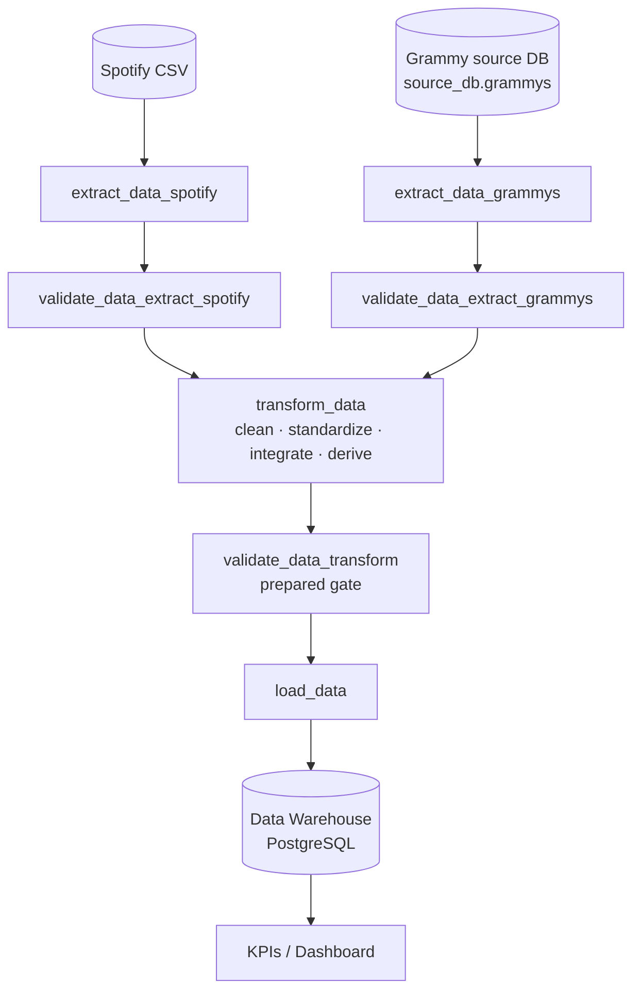
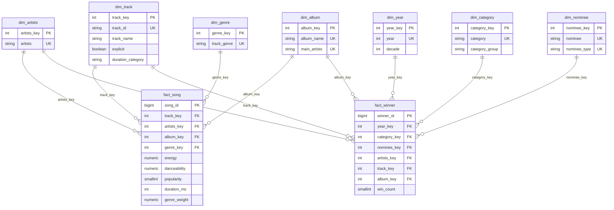

# Reliable Spotify–Grammy Batch Data Pipeline

**Course:** ETL (G01) · **Workshop-2:** Building a Reliable Batch Data Pipeline
**Program:** Data Engineering and Artificial Intelligence — Universidad Autónoma de Occidente

A batch pipeline that integrates **Spotify tracks (CSV)** with **Grammy Awards winners (PostgreSQL source database)**,
validates the data with **Great Expectations** at a raw gate and a prepared gate, orchestrates everything with
**Apache Airflow 3.1.8 (TaskFlow API)**, and loads a **dimensional Data Warehouse (star/constellation schema) in PostgreSQL**
that feeds the KPIs and the dashboard.

> **Status legend used in this document**
> `Implemented` = built and exercised · `TODO` = evidence or implementation still to be attached before submission.

---

## Table of contents

1. [Problem and analytical objective](#1-problem-and-analytical-objective)
2. [Analytical requirements](#2-analytical-requirements)
3. [Data sources](#3-data-sources)
4. [Pipeline architecture](#4-pipeline-architecture)
5. [Repository structure](#5-repository-structure)
6. [Setup and execution instructions](#6-setup-and-execution-instructions)
7. [Data profiling findings](#7-data-profiling-findings)
8. [Quality risks and quality rules](#8-quality-risks-and-quality-rules)
9. [Great Expectations validation design](#9-great-expectations-validation-design)
10. [Transformation and integration strategy](#10-transformation-and-integration-strategy)
11. [Dimensional model](#11-dimensional-model)
12. [Airflow DAG design](#12-airflow-dag-design)
13. [Failure and retry policy](#13-failure-and-retry-policy)
14. [Successful execution evidence](#14-successful-execution-evidence)
15. [Controlled failure evidence](#15-controlled-failure-evidence)
16. [Repeatability strategy](#16-repeatability-strategy)
17. [Dashboard and analytical outputs](#17-dashboard-and-analytical-outputs)
18. [End-to-end traceability matrix](#18-end-to-end-traceability-matrix)
19. [Reliability evidence register](#19-reliability-evidence-register)
20. [Assumptions and limitations](#20-assumptions-and-limitations)

---

## 1. Problem and analytical objective

Which characteristics distinguish the songs and albums that win a Grammy? Spotify describes songs (genre, audio
features, popularity) but knows nothing about awards. The Grammy dataset records awards but knows nothing about
genres or audio features. Neither source answers the question alone, so the pipeline integrates them and publishes a
trusted Data Warehouse.

**Objective:** analyze the distinguishing characteristics of award-winning songs in order to identify the factors that
make a song or an album deserve a Grammy.

**Scope.** Spotify: all tracks in the provided CSV (one row per track and genre). Grammy: ceremonies from 1958 to 2019,
winners only. The pipeline is a daily batch; it does not process streaming data or later ceremonies.

## 2. Analytical requirements

| ID | Analytical requirement | Business question | Required data (source) | Expected KPI(s) | Level of detail |
|---|---|---|---|---|---|
| **R1** | Analyze the distribution among the most awarded albums in the Grammys | Which albums have received the most Grammy awards? | `nominee`, `artist`, `category`, `year` (Grammy); `album_name`, `track_name`, `artists` (Spotify) | Top-N albums by total awards, first and last award year, awards by category group | One row per album |
| **R2** | Identify the genres where most awards concentrate | Which music genres have received the most Grammy awards? | `nominee`, `artist`, `category`, `year` (Grammy); `track_genre` (Spotify) | Share of awards by genre, category-group × genre matrix, trend by decade | Award × genre (weighted) |
| **R3** | Characterize the factors of the most awarded songs | What do the most awarded songs have in common? | `category`, `nominee` (Grammy); `track_name`, `artists`, `explicit`, `energy`, `danceability`, `popularity`, `duration_ms` (Spotify) | Mean/variance of energy, danceability and duration; popularity distribution; % explicit; mean, median and standard deviation table | One row per awarded song |

**Why both sources are needed.** R1 needs Grammy for the awards and Spotify to attribute the awards won by a song to its
album. R2 needs Grammy for the awards and Spotify for the genre. R3 needs Grammy to know which songs won and Spotify
for their audio features. The link between the two sources is the integration contract in
[section 10](#10-transformation-and-integration-strategy).

`loudness` is intentionally **not** used.

## 3. Data sources

| Source | Provided form | Extraction source in the pipeline | Facts |
|---|---|---|---|
| Spotify | CSV file | CSV file `data/spotify_dataset.csv` | 114,000 rows × 21 columns; one row per track and genre |
| Grammy Awards | CSV file | PostgreSQL table `source_db.grammys` | 4,810 rows × 10 columns; ceremonies 1958–2019 |

The Grammy CSV is preserved in `data/the_grammy_awards.csv`. It is loaded **once** into PostgreSQL by
`sql/source_setup.sql` (source preparation). The operational pipeline reads Grammy data **only from the database**
(`src/extract_grammy.py` runs `SELECT * FROM source_db.grammys`), never from the CSV. Loading the CSV is *source
preparation*, not the ETL load; the ETL load writes into the Data Warehouse ([section 11](#11-dimensional-model)).

## 4. Pipeline architecture



| Guide task name | DAG task | Module |
|---|---|---|
| `extract_spotify` | `extract_data_spotify` | `src/extract_spotify.py` |
| `validate_spotify_raw` | `validate_data_extract_spotify` | `gx/validation_extract.py` |
| `extract_grammys` | `extract_data_grammys` | `src/extract_grammy.py` |
| `validate_grammys_raw` | `validate_data_extract_grammys` | `gx/validation_extract.py` |
| `transform_and_integrate` | `transform_data` | `src/transform.py` |
| `validate_prepared` | `validate_data_transform` | `gx/validacion_transform.py` |
| `load_dw` | `load_data` | `src/load.py` |

**Technology.** Apache Airflow 3.1.8 (CeleryExecutor, Redis, Docker Compose) · PostgreSQL 16 · Great Expectations 1.x ·
pandas · SQLAlchemy.

**Task interfaces.** Tasks exchange **file paths**, not data. Each task writes a Parquet file under
`/opt/airflow/data/staging` and returns its path through XCom, so the Airflow metadata store is never used as a bulk-data
transport. Parquet also preserves data types (booleans, nullable integers), which JSON does not.

**Database layout.** One PostgreSQL instance: the Grammy source lives in schema `source_db`, the Data Warehouse in
schema `public`, and Airflow keeps its metadata in the same database.

## 5. Repository structure

```text
workshop-2/
├── dags/
│   └── reliable_music_pipeline.py      # Orchestration DAG (Airflow TaskFlow)
├── src/
│   ├── extract_spotify.py              # Spotify CSV extraction
│   ├── extract_grammy.py               # Grammy extraction from PostgreSQL
│   ├── transform.py                    # Cleaning, standardization & integration
│   └── load.py                         # Data Warehouse load (Star Schema)
├── gx/
│   ├── notebooks/                      # Data profiling notebooks
│   │   ├── data_profiling.ipynb        # Spotify profiling
│   │   └── data_profiling_grammy.ipynb # Grammy profiling
│   ├── validation_extract.py           # Raw validation gates (Spotify & Grammy)
│   └── validacion_transform.py         # Prepared dataset validation gate
├── sql/
│   ├── source_setup.sql                # Source schema setup & Grammy seed import
│   └── dw_schema.sql                   # Dimensional Data Warehouse DDL schema
├── data/
│   ├── staging/                        # Intermediate Parquet files
│   ├── spotify_dataset.csv             # Spotify raw dataset
│   └── the_grammy_awards.csv          # Grammy raw seed dataset
├── docs/
│   └── evidence/                       # Validation JSON/CSV evidence & screenshots
├── .env.example                        # Required environment variables template
├── .gitignore                          # Git ignore configuration
├── docker-compose.yaml                 # Docker services orchestration
├── Historia de los Grammys.pbix        # Power BI 3-page Dashboard
├── README.md                           # Main project documentation
└── requirements.txt                    # Python dependencies
```

## 6. Setup and execution instructions

### 6.1 Prerequisites

Docker and Docker Compose. Place the two input files in `data/`:

| File | Path |
|---|---|
| Spotify dataset | `data/spotify_dataset.csv` |
| Grammy dataset (original, never modified) | `data/the_grammy_awards.csv` |

### 6.2 Environment variables

Copy `.env.example` to `.env` and set your own values. **`.env` is never committed.**

```dotenv
POSTGRES_USER=postgres
POSTGRES_PASSWORD=change_me
POSTGRES_DB=postgres
POSTGRES_PORT=5432

AIRFLOW_UID=50000
AIRFLOW__API_AUTH__JWT_SECRET=change_me
_AIRFLOW_WWW_USER_USERNAME=airflow
_AIRFLOW_WWW_USER_PASSWORD=change_me
```

### 6.3 Start the environment

```bash
docker compose up airflow-init      # initializes the Airflow metadata database
docker compose up -d                # starts postgres, redis and all Airflow services
docker compose ps                   # every service should be healthy
docker compose exec airflow-apiserver airflow version     # expected: 3.1.8
```

The Airflow UI is at <http://localhost:8080>.

The `postgres` service mounts the Grammy CSV and the source setup script so the source database is created
reproducibly:

```yaml
volumes:
  - ./sql/source_setup.sql:/docker-entrypoint-initdb.d/01_source_setup.sql
  - ./data/the_grammy_awards.csv:/seed/the_grammy_awards.csv:ro
```

Files in `docker-entrypoint-initdb.d` run **only when the database volume is created for the first time**. Because
`source_setup.sql` is idempotent (`TRUNCATE` + `COPY`), it can also be re-run without recreating the volume:

```bash
docker compose exec -T postgres psql -U postgres -d postgres < sql/source_setup.sql
```

### 6.4 Source reconciliation (Grammy CSV ↔ source table)

```bash
# rows in the original CSV
python -c "import pandas as pd; print(len(pd.read_csv('data/the_grammy_awards.csv')))"
# rows in the source table
docker compose exec postgres psql -U postgres -d postgres -c "SELECT count(*) FROM source_db.grammys;"
```

Expected: **4,810** in both. Additional checks: 6 null `nominee`, 1,840 null `artist`, and `winner = true` in all 4,810
rows (see [section 7](#7-data-profiling-findings)).

### 6.5 Run the pipeline

In the UI, unpause `reliable_music_pipeline` and trigger it, or:

```bash
docker compose exec airflow-scheduler airflow dags trigger reliable_music_pipeline
```

Task states and logs are available in the Grid and Graph views.

## 7. Data profiling findings

The reproducible profiling is in `notebooks/data_profiling.ipynb`. Profiling only observes the data; it never
modifies it.

### Spotify (114,000 rows × 21 columns)

| Attribute | Evidence |
|---|---|
| `track_id` | 0 missing, 89,741 distinct. It repeats because the same track appears once per genre; the rest of the row is identical except `track_genre` |
| `artists` | 1 missing, 31,437 distinct. Several artists can be packed in one string separated by `;` |
| `track_name` | 1 missing, 73,608 distinct |
| `album_name` | 1 missing, 46,589 distinct. The three missing values belong to the same row |
| `explicit` | 0 missing, 2 distinct values |
| `energy`, `danceability` | 0 missing; 2,083 and 1,174 distinct values; range [0, 1] |
| `popularity` | 0 missing, 101 distinct values, range [0, 100] |
| `duration_ms` | 0 missing, 50,697 distinct; 17 rows (0.015%) are shorter than 30,000 ms |

### Grammy (4,810 rows × 10 columns)

| Attribute | Evidence |
|---|---|
| `year` | 0 missing, 62 distinct, 1958–2019. Year 2019 has 433 rows while the median year has 75 |
| `category` | 638 distinct values (629 after whitespace and case normalization), e.g. `Non-classical` vs `Non-Classical` |
| `nominee` | 6 missing, 4,131 distinct. The 6 rows are empty (no `artist` and no `workers` either) |
| `artist` | 38.3% missing (1,840 rows). Not an error: in categories such as *Song Of The Year* only the song is awarded, and in *Best New Artist* the artist is the `nominee` |
| `winner` | `True` in all 4,810 rows, so it does not discriminate winners from nominees |

### Profiling → quality risk

| Dataset / attribute | Profiling evidence | Potential quality risk | Related requirement |
|---|---|---|---|
| Spotify `track_id` | Repeats once per genre | Counting rows as songs inflates every measure | R2, R3 |
| Spotify `artists`, `track_name`, `album_name` | 1 missing row | Nulls break matching and album attribution | R1, R3 |
| Spotify `energy`, `danceability`, `popularity` | Documented valid ranges | Out-of-range values distort averages | R3 |
| Spotify `duration_ms` | 17 rows < 30 s | Extreme values distort averages | R3 |
| Grammy `winner` | Constant `True` | Nominees counted as winners | R1, R2, R3 |
| Grammy `category` | 638 labels with spelling variants | Unreadable analysis, split counts | R1, R2 |
| Grammy `nominee` | 6 empty rows | Rows without information | R1, R2, R3 |
| Grammy `artist` | 38.3% missing by design | Artist-based matching fails | R1, R3 |
| Cross-source | No shared key; Spotify `artists` lists | Text matching can miss or mismatch | R1, R2, R3 |
| Grammy `year` | Valid range 1958–2019 | Impossible years | R2 |

## 8. Quality risks and quality rules

Thresholds are engineering decisions tied to the profiling evidence and to the protected requirement. A threshold of
100% is used where a single bad row would make the analysis unsafe; 98% tolerates isolated source defects (profiling shows
at most 1 affected row in 114,000, or 6 in 4,810) without hiding structural failures.

### 8.1 Raw gates (Spotify and Grammy)

| Rule ID | Dataset | Attribute(s) | Dimension | Quality rule | Metric / threshold | Severity | Req. |
|---|---|---|---|---|---|---|---|
| S01 | Spotify raw | `track_id` | Completeness | Must be present | ≥ 100% non-null | Critical | R2, R3 |
| S02 | Spotify raw | `artists` | Completeness | Must be present | ≥ 98% non-null | Critical | R1, R3 |
| S03 | Spotify raw | `track_name` | Completeness | Must be present | ≥ 98% non-null | Critical | R3 |
| S04 | Spotify raw | `album_name` | Completeness | Must be present | ≥ 98% non-null | Critical | R1 |
| S05 | Spotify raw | `explicit` | Validity | Only `True` or `False` | ≥ 98% in set | Warning | R3 |
| S06 | Spotify raw | `energy` | Validity | Between 0 and 1 | ≥ 98% in range | Critical | R3 |
| S07 | Spotify raw | `popularity` | Validity | Between 0 and 100 | ≥ 98% in range | Critical | R3 |
| S08 | Spotify raw | `duration_ms` | Validity | Greater than or equal to 0 | 100% | Critical | R3 |
| S09 | Spotify raw | `danceability` | Validity | Between 0 and 1 | ≥ 98% in range | Critical | R3 |
| S10 | Spotify raw | `duration_ms` | Validity | At least 30,000 ms | 100% | Warning | R3 |
| G01 | Grammy raw | `year` | Validity | Not before 1958 (first ceremony) | 100% | Critical | R2 |
| G02 | Grammy raw | `year` | Validity | Within [1958, 2019] | ≥ 98% | Warning | R2 |
| G03 | Grammy raw | `category` | Completeness | Must be present | ≥ 98% non-null | Critical | R1, R2 |
| G04 | Grammy raw | `nominee` | Completeness | Must be present | ≥ 98% non-null | Critical | R1, R2, R3 |

### 8.2 Prepared gate

The prepared dataset mixes Spotify-side and Grammy-side rows, so each rule is evaluated only on the rows it applies to
(`match_status`).

| Rule ID | Attribute(s) | Dimension | Quality rule | Threshold | Severity |
|---|---|---|---|---|---|
| P01 | 24 prepared columns | Validity (schema) | All columns of the dimensional model exist | 100% | Critical |
| P02 | `match_status` | Validity | Only `both`, `spotify_only`, `grammy_only` | 100% | Critical |
| P03 | `nominee_type` | Validity | Only `song`, `album`, `artist`, `unknown` | 100% | Critical |
| P04 | `track_id`, `track_genre`, `year`, `category`, `nominee` | Uniqueness | The integration did not multiply rows | 100% unique | Critical |
| P05 | `win_count` | Consistency | Every winner counts exactly 1 | 100% | Critical |
| P06 | `track_id` (song winners) | Completeness | Minimum share of song winners matched in Spotify | ≥ 5% (provisional) | Warning |
| P07 | `winner_album_name` (album winners) | Completeness | Minimum share of album winners matched in Spotify | ≥ 5% (provisional) | Warning |
| P08 | `track_id` (Spotify rows) | Completeness | Not null | 100% | Critical |
| P09 | `track_genre` (Spotify rows) | Completeness | Not null | 100% | Critical |
| P10 | `energy`, `danceability` | Validity | Between 0 and 1 | 100% | Critical |
| P11 | `popularity` | Validity | Between 0 and 100 | 100% | Critical |
| P12 | `genre_weight` | Validity | Greater than 0 and at most 1 | 100% | Critical |
| P13 | `duration_ms` | Validity | At least 30,000 ms | ≥ 99% | Warning |
| P14 | `duration_category` | Validity | Only `Corta`, `Media`, `Larga` | 100% | Critical |
| P15 | `year` (Grammy rows) | Validity | Within [1958, 2019] | 100% | Critical |
| P16 | `category_group` | Validity | Belongs to the group catalogue | 100% | Critical |
| P17 | `grammy_artists` | Completeness | Known artist | ≥ 60% (profiling: ~69%) | Warning |
| P18 | `category_group` | Completeness | Not left in `Other` | ≥ 85% (profiling: ~93%) | Info |

Each rule is justified by profiling evidence, an analytical requirement, or a post-transformation invariant:
P01–P05 and P14 are post-transformation invariants; P08–P13 and P15 protect the ranges documented in the profiling;
P06, P07, P17 and P18 monitor integration quality and the heuristics of the transformation. **P06 and P07 are provisional**:
their thresholds must be fixed after measuring the match rate on the full Spotify file (see [section 20](#20-assumptions-and-limitations)).

## 9. Great Expectations validation design

| Design element | Raw – Spotify | Raw – Grammy | Prepared |
|---|---|---|---|
| Validated data object | Spotify DataFrame | Grammy DataFrame (from PostgreSQL) | Integrated DataFrame (24 columns) |
| Data Source / Asset | `Spotify_pandas_source` / `Spotify_applications` | `Spotify_pandas_source` / `Grammys_applications` | `Prepared_pandas_source` / `Prepared_integrated` |
| Batch Definition | `whole_spotify_dataframe` | `whole_grammys_dataframe` | `whole_prepared_dataframe` |
| Expectation Suite | `spotify_suite` (S01–S10) | `grammys_suite` (G01–G04) | `prepared_suite` (P01–P18) |
| Validation Definition | `spotify_validation_definition` | `grammys_validation_definition` | `prepared_validation_definition` |
| Checkpoint | `candidate_validation_checkpoint` | `grammys_validation_checkpoint` | `prepared_validation_checkpoint` |

**Rule ID ↔ Expectation mapping.**

- *Prepared gate:* every expectation carries its Rule ID in `meta={"rule_id": "Pxx"}`, so the mapping is stored in the
  validation result itself. `energy` and `danceability` are two expectations under the same rule P10, which gives 19
  expectations for 18 rules.
- *Raw gates:* the mapping is the table in [section 8.1](#81-raw-gates-spotify-and-grammy). Each rule corresponds to the
  expectation on the same column, type, bounds and `mostly` value in `gx/validation_extract.py`.

**Severity policy.**

| Severity | Pipeline action |
|---|---|
| Critical | Stop the affected downstream path. The gate task fails and downstream tasks do not run (`upstream_failed`) |
| Warning | Record, expose in the task log, and continue |
| Info | Record for monitoring; never blocks |

**Results and evidence.** The prepared gate saves, on every run, a full JSON result and a per-rule CSV summary
(`rule_id`, expectation, column, severity, success, element and unexpected counts) in `docs/evidence/`. Raw gate results are
recorded in the task logs.

> **Status — raw gates:** the policy above is the target behavior. The raw gate functions currently print their results and
> the checkpoint outcome. They must end with the severity policy (raise an error when a *Critical* rule fails) for the
> controlled-failure test of [section 15](#15-controlled-failure-evidence) to turn the task red. **TODO:** confirm before
> submission and delete this note.

## 10. Transformation and integration strategy

Transformation is a single phase (`transform_data`): cleaning, standardization, derivation and integration. Rules are
defensible on their own, independently of any validation result: no rule exists only to make a validation pass.
The function returns **one integrated dataset** with all the columns of the dimensional model and prints its row counts
to the task log.

### 10.1 Decision record

| # | Rule and rationale | Affected fields | Before → after | Exception handling | Analytical impact |
|---|---|---|---|---|---|
| T1 | Remove Spotify rows with no artist, album and track name: they cannot be identified | all | 1 empty row removed | Counted and printed | R1, R3 |
| T2 | Remove exact duplicates on (`track_id`, `track_genre`), keeping the most popular | all | One row per track and genre | Count printed | R2, R3 |
| T3 | Main artist = first value before `;`, normalized (lowercase, no accents) | `artists`, `main_artists` | `A;B;C` → `a` | Missing → `unknown` | R1, R3 |
| T4 | `genre_weight = 1 / number of genres of the track` | `genre_weight` | New column | — | R2 |
| T5 | `duration_category` in terciles (`Corta`, `Media`, `Larga`) over unique tracks | `duration_category` | New column | — | R3 |
| T6 | Normalize `category` (trim, collapse spaces, title case) | `category` | 638 → 629 labels | — | R1, R2 |
| T7 | `winner` is constant, so the winner is the **first row of each (`year`, `category`)** in source order (`id` ascending) | `winner`, all | 4,810 → 4,430 winners (380 non-winners removed) | Verified against known winners of Record, Album and Song of the Year 2014–2019 | R1, R2, R3 |
| T8 | Remove winners with neither nominee nor artist (applied after T7) | all | 6 empty rows removed | Counted and printed | R1–R3 |
| T9 | `nominee_type` (`song`, `album`, `artist`, `unknown`) derived from the category | `nominee_type` | New column | Unrecognized → `unknown` | R1, R2 |
| T10 | `category_group` (Pop, Rock, Rap, General Field, …) derived from the category | `category_group` | 629 labels → ~20 groups | Unmatched → `Other` | R1, R2 |
| T11 | Artist: if the nominee *is* the artist, copy it; otherwise recover it from another category of the same year with the same title | `grammy_artists` | 38.3% null → ~31% unknown among winners | Unrecoverable → `unknown` | R1, R3 |
| T12 | `decade` from `year` | `decade` | New column | — | R2 |

### 10.2 Integration contract

| Item | Decision and evidence |
|---|---|
| Integration key(s) | **Songs:** (normalized title, normalized artist) → Spotify `track_id`. **Albums:** (normalized album name, normalized artist) → Spotify (`album_name`, `main_artists`). Spotify matches any of the track's artists |
| Cardinality | One Grammy winner ↔ one Spotify track; one track ↔ N genres. In the integrated dataset a winner repeats once per genre (one-to-many). The load collapses it back |
| Preprocessing | Lowercase, remove accents, collapse spaces; for titles also remove parentheses, `feat.` and punctuation |
| Unmatched records | Kept as `grammy_only` rows (they feed R1 and the unknown member `-1`); measured by the match rate logged by the transform and checked by P06/P07 |
| Duplicate matches | A song with several `track_id` values (single and album) → the most popular is chosen, so rows are never multiplied |
| Album attribution | A song winner takes the album of its matched track; an album winner is matched directly |
| Reconciliation | After the merge the transform recovers the original Spotify and Grammy row counts; if either differs it raises an error |
| Assumptions and limitations | The match depends on text; titles written differently are not matched; see [section 20](#20-assumptions-and-limitations) |

`match_status` classifies every row: `both` (Spotify track with a Grammy award), `spotify_only`, or `grammy_only`.

## 11. Dimensional model

The model is a **fact constellation**: two business processes that share conformed dimensions
(`dim_artists`, `dim_track`, `dim_album`).

| Fact | Business process | Grain (one row represents) | Measures |
|---|---|---|---|
| `fact_song` | Sound characterization of songs by genre | One track, in one genre, by its main artist | `energy`, `danceability`, `popularity`, `duration_ms`, `genre_weight` |
| `fact_winner` | Grammy awards | One winner, in one category, in one year | `win_count` |



**Keys.** Every dimension has an integer **surrogate key** (`*_key`) and a **business key** with a `UNIQUE` constraint
(`track_id`; normalized artist name; (`album_name`, `main_artists`); `track_genre`; `year`; `category`;
(`nominee`, `nominee_type`)). Facts reference dimensions with foreign keys. A **`-1` "Unknown" member** exists in every
dimension for nulls and unmatched rows, so no fact row is lost.

**Uniqueness of facts.** `fact_song` has `UNIQUE (track_key, genre_key, artists_key)`; `fact_winner` has
`UNIQUE (year_key, category_key, nominee_key, artists_key)`. These constraints back the repeatability strategy.

**Why `track_id` is not unique in `fact_song`.** The same track appears in several genres, so the dimension holds one
row per track and the fact holds one row per track and genre.

**Requirement support.**

| Requirement | Path in the model |
|---|---|
| R1 | `fact_winner` → `dim_album` (and `dim_category`, `dim_year`) |
| R2 | `fact_winner` → `fact_song` through `track_key` → `dim_genre`, weighted by `genre_weight` |
| R3 | `fact_winner` → `fact_song` through `track_key` for the audio measures, with `dim_track` |

Aggregate each fact separately and join through a conformed dimension (*drill-across*). Joining the two facts directly
multiplies rows.

The executable schema is `sql/dw_schema.sql`.

## 12. Airflow DAG design

`dags/reliable_music_pipeline.py` uses the TaskFlow API (`from airflow.sdk import dag, task`) and contains orchestration
only; the logic lives in `src/` and `gx/`.

| Task | Purpose | Output (path) | Retries |
|---|---|---|---|
| `start` | Creates the staging folder | — | 0 |
| `extract_data_spotify` | Reads the Spotify CSV | `staging/spotify_raw.parquet` | 2, delay 1 min |
| `validate_data_extract_spotify` | Raw gate (S01–S10) | same path | 0 |
| `extract_data_grammys` | Reads `source_db.grammys` from PostgreSQL | `staging/grammys_raw.parquet` | 2, delay 1 min |
| `validate_data_extract_grammys` | Raw gate (G01–G04) | same path | 0 |
| `transform_data` | Transform and integrate | `staging/integrated.parquet` | 0 |
| `validate_data_transform` | Prepared gate (P01–P18) | same path | 0 |
| `load_data` | Loads the Data Warehouse | — | 0 |

**Dependencies.** The two source branches run in parallel. `transform_data` depends on both validated branches, so it
cannot start until both raw gates pass. `load_data` depends on `validate_data_transform`, so nothing is loaded unless the
prepared gate succeeds.

**Logging.** Every task prints batch context: rows extracted per source, rows removed by each cleaning rule, artist and
match rates, rows per `match_status`, reconciliation result, validation outcome per rule, and rows loaded per table.

## 13. Failure and retry policy

Retries are applied **only** to transient operational failures; deterministic data or contract failures are not
retried because repeating them reproduces the same result.

| Condition | Severity / type | Pipeline response | Retry? | Justification |
|---|---|---|---|---|
| Database connection lost during Grammy extraction | Transient operational | Retry, then fail the task | Yes: 2 × 1 min | Another attempt can succeed without changing input or code |
| Spotify CSV unreadable or temporarily unavailable | Transient operational | Retry, then fail the task | Yes: 2 × 1 min | Same as above (file-system hiccup) |
| Source extracted with 0 rows | Deterministic | Fail the task immediately (`AirflowFailException`) | No | Retrying an empty source gives the same result |
| Raw gate: a *Critical* rule fails | Critical | Stop the branch; transform, prepared gate and load are `upstream_failed` | No | The same data would fail again |
| Raw gate: a *Warning* rule fails | Warning | Log and continue | No | Does not invalidate the batch |
| Transform: reconciliation mismatch or empty input | Deterministic | `ValueError`, task fails | No | The integration is unsafe |
| Prepared gate: a *Critical* rule fails | Critical | Task fails with the rule IDs; `load_data` does not run | No | Loading would corrupt the Data Warehouse |
| Prepared gate: *Warning* or *Info* | Warning / Info | Log, save evidence, continue | No | Monitoring signal |
| Data Warehouse load fails | Operational | Task fails; no automatic retry | No | A retry is safe only after the truncate-and-load strategy of [section 16](#16-repeatability-strategy) is in place |

## 14. Successful execution evidence

**Test A:** run the full pipeline with valid inputs.

| Stage | Expected result |
|---|---|
| Extract both sources | Success; row counts in the logs |
| Raw validation gates | Success under the documented policy (Warning allowed) |
| Transform and integrate | Success with reconciliation evidence in the log |
| Prepared validation | Success; result saved in `docs/evidence/` |
| Load | Success with row counts per table |
| Analytics | Queries and dashboard reflect Data Warehouse data |

> **TODO:** attach the Grid view with all tasks green, the task logs, the prepared validation JSON/CSV, and the load row
> counts under `docs/evidence/`, each with a short interpretation.

## 15. Controlled failure evidence

**Test B:** make one Critical raw rule fail on purpose and show that the failure is visible and blocks the downstream path.

### Option 1 — Grammy source (one-line switch, recommended)

Violated rule: **G01** (`year` not before 1958, Critical, 100%). The Grammy Awards started in 1958; the test table holds
the real data plus one row with `year = 1900`.

```bash
# 1. create the invalid table (a copy of source_db.grammys with one bad row)
docker compose exec -T postgres psql -U postgres -d postgres < sql/source_invalid_setup.sql
```

2. In `src/extract_grammy.py`, change **one line**:

```python
query = "SELECT * FROM source_db.grammys;"            # normal run (Test A)
query = "SELECT * FROM source_db.grammys_invalid;"    # controlled failure (Test B)
```

3. Trigger the DAG. 4. Restore the line afterwards.

### Option 2 — Spotify source

Violated rule: **S01** (`track_id` present in 100% of rows, Critical).

```bash
python scripts/make_invalid_spotify.py     # writes data/spotify_dataset_invalid.csv (original untouched)
```

Point the Spotify path to `data/spotify_dataset_invalid.csv` in the DAG task `extract_data_spotify` and in `DATA_PATH` of
`validations_spotify()` (two lines, because the raw gate reads the file itself).

### Expected behavior

| Stage | Expected result |
|---|---|
| Extract affected source | Success |
| Affected raw validation | **Failure** (rule G01 or S01) |
| Downstream transformation | Does not run (`upstream_failed`) |
| Prepared validation and load | Do not run (`upstream_failed`) |
| Evidence | Failed task log with the failing rule, the GX validation result, and the Grid view |

> **TODO:** attach the Graph/Grid view, the failed task state, the GX result (`unexpected_count: 1`), the failed task log,
> and a short explanation of the blocking rule and the downstream behavior. See the status note of
> [section 9](#9-great-expectations-validation-design) about the raw gate raising an error.

## 16. Repeatability strategy

**Chosen strategy: truncate-and-load inside a single transaction (replace).** The load empties the dimensions and facts and
reloads the same validated batch within one transaction, so a rerun of the same batch produces the same Data Warehouse
and a failure in the middle rolls everything back instead of leaving a partial load. The `UNIQUE` constraints of
[section 11](#11-dimensional-model) remain as a second line of defense, and the `-1` unknown members are re-created by
`sql/dw_schema.sql` on every run.

> **Status:** the current `load_data` appends and relies on the `UNIQUE` constraints. A second run of the same batch
> therefore **fails with a unique-violation error and creates no duplicates** (verified), but it does not yet succeed
> idempotently. **TODO:** implement the transactional truncate-and-load in `load_dw`, then run the comparison below.

**Safe-rerun demonstration.**

```bash
# row counts before and after the rerun (they must be identical)
docker compose exec postgres psql -U postgres -d postgres -c "
  SELECT 'fact_song' t, count(*) FROM fact_song
  UNION ALL SELECT 'fact_winner', count(*) FROM fact_winner
  UNION ALL SELECT 'dim_track',   count(*) FROM dim_track
  UNION ALL SELECT 'dim_album',   count(*) FROM dim_album;"
# a selected measure
docker compose exec postgres psql -U postgres -d postgres -c "SELECT sum(win_count) FROM fact_winner;"
```

> **TODO:** attach the counts before/after the rerun and the Grid view of the second run.

**Partially completed or failed run.** Upstream of the load, nothing is written to the Data Warehouse, so a failure leaves
it untouched. During the load, the single transaction rolls back and the previous state is preserved.

## 17. Dashboard and analytical outputs

All outputs query the Data Warehouse (no direct CSV connection). BI tool: **TODO** (Power BI / Tableau / Looker Studio).

| Requirement | DW element / query | KPI / visualization |
|---|---|---|
| R1 | `fact_winner` ⨝ `dim_album` ⨝ `dim_year` | Top-N albums by awards (table), cumulative wins per album (bar chart), awards by category group |
| R2 | `fact_winner` ⨝ `fact_song` ⨝ `dim_genre`, weighted by `genre_weight` | Share of awards by genre (treemap), category group × genre (heatmap), trend by decade |
| R3 | `fact_song` ⨝ awarded tracks | Audio profile of awarded vs not-awarded songs (radar / boxplots), popularity distribution, % explicit, statistics table |

```sql
-- R1: most awarded albums
SELECT a.album_name, a.main_artists, SUM(w.win_count) AS awards,
       MIN(y.year) AS first_award_year, MAX(y.year) AS last_award_year
FROM fact_winner w
JOIN dim_album a ON a.album_key = w.album_key
JOIN dim_year  y ON y.year_key  = w.year_key
WHERE w.album_key <> -1
GROUP BY a.album_name, a.main_artists
ORDER BY awards DESC, a.album_name
LIMIT 10;

-- R2: awards by genre (a song in several genres is split by genre_weight)
SELECT g.track_genre, ROUND(SUM(s.genre_weight)::numeric, 2) AS weighted_awards
FROM fact_winner w
JOIN fact_song  s ON s.track_key = w.track_key
JOIN dim_genre  g ON g.genre_key = s.genre_key
WHERE w.track_key <> -1
GROUP BY g.track_genre
ORDER BY weighted_awards DESC;

-- R3: awarded vs not-awarded songs (genre-weighted averages)
WITH awarded AS (SELECT DISTINCT track_key FROM fact_winner WHERE track_key <> -1)
SELECT CASE WHEN aw.track_key IS NULL THEN 'Not awarded' ELSE 'Awarded' END AS grp,
       COUNT(DISTINCT s.track_key) AS songs,
       ROUND((SUM(s.energy * s.genre_weight)       / SUM(s.genre_weight))::numeric, 3) AS avg_energy,
       ROUND((SUM(s.danceability * s.genre_weight) / SUM(s.genre_weight))::numeric, 3) AS avg_danceability,
       ROUND((SUM(s.popularity * s.genre_weight)   / SUM(s.genre_weight))::numeric, 1) AS avg_popularity
FROM fact_song s
LEFT JOIN awarded aw ON aw.track_key = s.track_key
GROUP BY 1
ORDER BY 1;
```

> **TODO:** add the dashboard screenshots (cropped, each with its interpretation) and the connection details to the
> Data Warehouse under `docs/evidence/`.

## 18. End-to-end traceability matrix

| Requirement | Required data | Quality risk | DQ rule | GX expectation | Transformation | DW element | KPI / visualization |
|---|---|---|---|---|---|---|---|
| R1 | `nominee`, `artist`, `category`, `year`, `album_name` | Awards cannot be attributed to an album (text mismatch) | P07 | `ExpectColumnValuesToNotBeNull(winner_album_name)` on album winners | T7, T9, album attribution ([10.2](#102-integration-contract)) | `fact_winner.album_key`, `dim_album` | Top-N albums |
| R2 | `track_genre`, `genre_weight`, `year` | A track repeated per genre inflates award counts | P04, P12 | `ExpectCompoundColumnsToBeUnique`, `ExpectColumnValuesToBeBetween(genre_weight)` | T2, T4, T12 | `fact_song.genre_weight`, `dim_genre`, `dim_year.decade` | Genre concentration, decade trend |
| R3 | `energy`, `danceability`, `popularity`, `duration_ms` | Out-of-range audio features distort averages | S06, S09, P10, P11 | `ExpectColumnValuesToBeBetween` | T5 | `fact_song` measures, `dim_track.duration_category` | Audio profile of awarded songs |
| R1, R2 | `category` | 638 labels make the analysis unreadable | P16, P18 | `ExpectColumnValuesToBeInSet(category_group)` | T6, T10 | `dim_category.category_group` | Heatmap, awards by category group |

## 19. Reliability evidence register

| Evidence ID | Run / task | Artifact or path | What it proves | Related policy / rule | Status |
|---|---|---|---|---|---|
| E-01 | Source preparation | `sql/source_setup.sql` output; row counts of section 6.4 | The Grammy source table reconciles with the CSV (4,810 rows) | Section 6.4 | TODO |
| E-02 | Test A, whole DAG | `docs/evidence/` Grid view + logs | Successful end-to-end run | Section 14 | TODO |
| E-03 | `validate_data_transform` | `docs/evidence/validate_prepared_*.json` / `*_summary.csv` | Prepared gate passes; per-rule evidence | P01–P18 | TODO |
| E-04 | Test B, `validate_data_extract_grammys` | Failed task log + GX result | Controlled Critical failure blocks the downstream path | G01 | TODO |
| E-05 | Test B, downstream tasks | Grid view | `transform_data`, `validate_data_transform`, `load_data` are `upstream_failed` | Section 13 | TODO |
| E-06 | Selective retry | Extract task log with retry attempts, or this justification | Retries only on transient extraction failures; none elsewhere | Section 13 | TODO |
| E-07 | Safe rerun | Row counts before/after the second run | A rerun does not duplicate or corrupt the Data Warehouse | Section 16 | TODO |
| E-08 | Analytics | Dashboard screenshots + queries | Outputs come from the Data Warehouse | Section 17 | TODO |

## 20. Assumptions and limitations

- **Integration is text-based.** Spotify and Grammy share no identifier. Songs are matched on normalized title and artist,
  albums on normalized name and artist. Differently written titles are not matched, and the match rate depends on the age
  and genre of the repertoire (classical and instrumental winners rarely exist in Spotify). The **real match rate must be
  measured** on the full Spotify file and used to fix the provisional thresholds of P06 and P07.
- **Winner derivation is a heuristic.** `winner` is constant, so the winner is the first row per (`year`, `category`).
  It was checked against known winners of the main categories (2014–2019), not against an official list. Ties and co-winners
  in earlier years are reduced to one row (about 31 groups).
- **Year 2019 contains nominees.** Only the first row of each category is kept as winner; the other 2019 nominees are
  excluded (380 non-winner rows overall).
- **Missing artists in Grammy.** About 31% of winners keep an unknown artist after recovery (songwriter categories),
  which limits artist-based matching and artist-based analysis.
- **Album identity.** Spotify has no album identifier, so an album is (`album_name`, main artist). Compilations and
  different editions of an album are separate albums.
- **Multi-artist tracks.** Only the main artist (first listed) is stored in `dim_artists`; the other artists are used only
  for matching.
- **Spotify has no date.** The temporal trend (R2) comes from the Grammy ceremony year only.
- **Duration terciles depend on the data.** `duration_category` cut points are recomputed from the Spotify batch.
- **Thresholds.** 98% / 100% thresholds are documented engineering decisions based on the profiling evidence; they
  should be revisited if the sources change.
- **Raw gate policy and safe rerun** have the implementation status stated in [section 9](#9-great-expectations-validation-design)
  and [section 16](#16-repeatability-strategy).
- **Single database instance.** Airflow metadata, the Grammy source schema, and the Data Warehouse share one PostgreSQL
  instance for simplicity; a production setup would separate them.
- **Security.** No credentials are committed; `.env.example` documents the required variables only.
